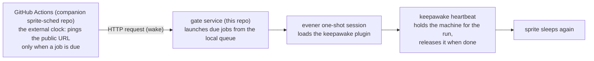

# evener-sched

Scheduled evener runs on a sprite: "make this happen in 4 hours", and it
happens — even though the machine sleeps whenever nothing holds it awake.

A sprite pauses ~30s after inbound activity stops, and nothing on the
machine can wake it. So scheduling splits in two:



- **`bin/sched`** — register/list/remove jobs. `sched add` writes the job
  spec to the local queue and pushes a wake entry to the companion GitHub
  repo (see `EVENER_SCHED_GH_CLONE` below).
- **`gate/gate.sh`** — run as a service (restarted on boot). Every 10s it
  launches due jobs as unattended one-shot evener sessions (`--max-rounds`
  bounds them). A job is launched exactly once; the gate never infers health
  from the CLI pid (the one-shot CLI exits before its session daemon
  finishes — the daemon inherits the log fd and completes the run). At
  launch the gate takes one 5-minute bridge task covering the gap until the
  session's keepawake marker appears.
- **Companion repo** (GitHub) holds `due.json` and two workflows: `wake.yml`
  (*/5 cron, pings when anything is due, marks entries fired) and
  `ping-at.yml` (dispatch for a guaranteed ping at an exact moment — use
  while the cron activates or when timing matters).

## Configuration

Machine-specific values live in one optional shared config file,
`~/.config/evener-sprite/config` (override its location with
`EVENER_SPRITE_CONFIG`), never committed. Precedence: per-tool env var >
config file > neutral built-in default. `config.example` documents every key.

| Key / per-tool env var | Meaning | Default |
|---|---|---|
| `DEFAULT_MODEL` / `EVENER_SCHED_MODEL` | model for fresh jobs (`provider/model`; empty = evener's own default) | empty |
| `PROVIDER_ENV` / `EVENER_SCHED_PROVIDER_ENV` | provider env file sourced before launches | unset → loud warn at launch, launch proceeds |
| `WORKDIR` / `EVENER_SCHED_WORKDIR` | where launched jobs run | `$HOME` |
| `NICE` / `EVENER_SCHED_NICE` | nice level for launched work | `10` |
| `EVENER_SCHED_STATE` | state dir (queue, markers, logs) | `~/.local/state/evener-sched` |
| `EVENER_SCHED_GH_CLONE` | wake-repo clone for `due.json` sync | `$HOME/projects/sprite-sched` |
| `EVENER_SCHED_RUN_DIR` | evener run dir (daemon liveness for steering) | `~/.local/state/evener/run` |
| `EVENER_SCHED_INTERVAL` | gate poll interval (seconds) | `10` |

## Usage

```bash
bin/sched add \
  --in "4 hours" --name tidy \
  --prompt "Run the test suite in <repo> and summarize failures."

# steer an existing session at a future time — the prompt becomes its next
# input, with the session's full context (it uses the session's own model):
bin/sched add --at "tomorrow 09:00" --resume-session <session-id> \
  --prompt "Continue the build and report."

bin/sched list          # job ids, due times, state, whether the wake fired
bin/sched rm <id>
```

Options: `--at "2026-11-25 14:00"` or `--in "90 minutes"`, `--prompt-file F`,
`--model M` (fresh jobs; default from config, empty = evener's own default),
`--max-rounds R` (default 40), `--resume-session <id>` (steer an existing
session).

**Steering semantics:** a live session cannot take external input — if the
target session's daemon is live at due time the gate waits (logged once in
`gate.log`) until it is idle/dead, then steers it; cancel a waiting job with
`sched rm`.

## Install

- Run `gate/gate.sh` as a service (it only reads its queue and launches
  `evener`; no root needed).
- Clone the companion sprite-sched repo and point `EVENER_SCHED_GH_CLONE`
  at it; `sched add` pushes wake entries to its `due.json`. A failed push is
  never fatal: the job stays in the local queue and still runs while the
  machine is up.

## Verify

- `~/.local/state/evener-sched/gate.log` — launches, CLI exits, resume gaps.
- `~/.local/state/evener-sched/logs/<id>.log` — the session's full output.
- `~/.local/state/evener-keepawake/heartbeat.log` — the machine's sleep/wake
  record (`resumed after Ns gap` lines) and what held it awake.
- `bash test/run.sh` — stub-based test suite (temp state dirs, stubbed
  `evener`/`curl`, a temp bare git remote; no live services touched).

## Limits

- One-shot only in v1: a due time, no recurring cadence. A job that comes
  due while the machine is up runs without needing the external wake.
- Timing is best-effort: GitHub's cron floor is 5 minutes, its schedule can
  lag further under load, and a wake boots the machine. For an exact
  moment, dispatch `ping-at.yml` and expect ~±1 minute.
- A scheduled job's session is an ordinary evener session (default
  `--max-rounds` 40); give smaller bounds for cheap work.
- Jobs run as the user with the provider env sourced; prompts live in the
  queue dir — do not put secrets in them.
- Job launches are niced (default `+10`): session work yields to the hub
  under load.
